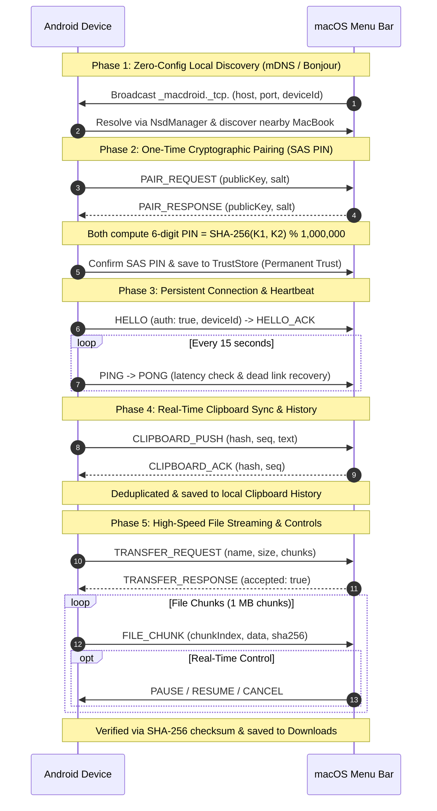

# DexoLink

[](https://github.com/rahulmahasetha/dexolink/releases)
[](https://github.com/rahulmahasetha/dexolink/actions/workflows/ci.yml)
[](https://github.com/rahulmahasetha/dexolink)
[](https://github.com/rahulmahasetha/dexolink)
[](https://github.com/rahulmahasetha/dexolink)
[](https://github.com/rahulmahasetha/dexolink)
[](LICENSE)

**DexoLink** enables seamless, zero-configuration peer-to-peer connectivity between macOS, iOS, Android, and Windows devices over local Wi-Fi. Inspired by Apple AirDrop and Handoff, DexoLink provides automatic device discovery, one-time cryptographic pairing, real-time bidirectional clipboard synchronization, multiple paired device management, native file streaming, and cross-device continuity—all without requiring an active internet connection or third-party cloud servers.

---

## Public App Downloads (v4.1.0)

> **Note:** Even though the project source code repository is kept private on GitHub, the compiled application packages are **publicly distributed** for anyone to install and run without building from source or logging in.

| Platform | Download Asset | Supported OS | Description |
|:---|:---|:---|:---|
| **macOS** | [**DexoLink.dmg**](https://github.com/rahulmahasetha/dexolink/releases/latest/download/DexoLink.dmg) | macOS 13.0+ (Ventura, Sonoma, Sequoia) | Drag & drop menu bar application (`DexoLink.app`) |
| **macOS (v4.1.0)** | [**DexoLink-v4.1.0.dmg**](https://github.com/rahulmahasetha/dexolink/releases/download/v4.1.0/DexoLink-v4.1.0.dmg) | macOS 13.0+ | Exact versioned DMG disk image |
| **Android** | [**DexoLink-Android.apk**](https://github.com/rahulmahasetha/dexolink/releases/latest/download/DexoLink-Android.apk) | Android 8.0+ (Oreo through Android 15) | Standalone APK package |
| **Android (v4.1.0)** | [**DexoLink-v4.1.0.apk**](https://github.com/rahulmahasetha/dexolink/releases/download/v4.1.0/DexoLink-v4.1.0.apk) | Android 8.0+ | Exact versioned APK package |
| **Windows (.exe)** | [**DexoLink.exe**](https://github.com/rahulmahasetha/dexolink/releases/latest/download/DexoLink.exe) | Windows 10 / 11 (64-bit) | Standalone native Windows executable app |
| **Windows (v4.1.0 .exe)** | [**DexoLink-v4.1.0.exe**](https://github.com/rahulmahasetha/dexolink/releases/download/v4.1.0/DexoLink-v4.1.0.exe) | Windows 10 / 11 | Exact versioned standalone executable app |
| **Windows (Source / GUI)** | [**`windows/run_windows_gui.bat`**](windows/README.md) | Windows 10 / 11 | Desktop GUI app (`dexolink_gui.py`) & launcher |
| **iPhone (iOS .ipa)** | [**DexoLink.ipa**](ios/README.md) | iOS 16.0+ (iPhone & iPad) | Standalone installable iOS package (`DexoLink.ipa`) |
| **iPhone (v4.1.0 .ipa)** | [**DexoLink-v4.1.0.ipa**](https://github.com/rahulmahasetha/dexolink/releases/download/v4.1.0/DexoLink-v4.1.0.ipa) | iOS 16.0+ | Exact versioned installable iOS package |

---

## Project Workflow

The following diagram and step-by-step phases illustrate the end-to-end operation of DexoLink between Android and macOS:

> **Interactive Protocol Demo:** Open [`demo/dexolink-demo.html`](demo/dexolink-demo.html) in your browser for a live UI simulator and animated end-to-end flow demo.



### End-to-End Workflow Stages

1. **Zero-Configuration Discovery (Local Subnet Only)**:
   - macOS broadcasts a local Bonjour service (`_macdroid._tcp.local.`) on port `52840`.
   - Android's background `NsdManager` listens and discovers the Mac instantly without cloud signaling, Bluetooth pairing, or manual IP entry.
   - Devices appear automatically with real-time signal status. Duplicate entries are automatically deduplicated.

2. **One-Time Cryptographic Pairing (SAS 6-Digit PIN)**:
   - Untrusted devices initiate pairing using a Short Authentication String (SAS).
   - Both devices deterministically derive a matching 6-digit confirmation PIN (`SHA-256(sorted(K1, K2)) % 1,000,000`).
   - Confirming links the cryptographic identities permanently into persistent `TrustStore` storage.

3. **Persistent Background Connection & Heartbeat Monitoring**:
   - Android runs a sticky Foreground Service with `WIFI_MODE_FULL_LOW_LATENCY` and wake lock.
   - macOS runs an event-driven background service in the menu bar.
   - An active 15-second heartbeat (`PING`/`PONG`) detects network drops and automatically reconnects with exponential backoff.

4. **Bidirectional Clipboard Synchronization**:
   - Text copied on either device is captured, hashed with SHA-256 to prevent feedback loops, and transmitted immediately.
   - Supports 3 modes: **Two-Way Sync**, **Android → Mac**, and **Mac → Android**.
   - Includes a persistent **Clipboard History** with single-item deletion and multi-select bulk delete.

5. **High-Speed File Transfer & Native Share Menu Integration**:
   - Integrated directly into the native system Share Menu on both Android and macOS ("Share with DexoLink").
   - Large files (up to 10 GB) are streamed in sequential 1 MB chunks with SHA-256 integrity checks.
   - **Real-Time Transfer Controls**: Active transfers feature instant **Pause ('||')**, **Resume ('Resume')**, and **Cancel ('Cancel')** without dropping paired socket connections.

6. **Safe History Management**:
   - Transfer and clipboard history records can be deleted individually or via long-press multi-select bulk deletion with confirmation dialogs.
   - **Guaranteed Safe**: Deleting history entries never deletes original physical files on disk and never disconnects paired devices.

---

## Features

- **Zero-Configuration Automatic Discovery (mDNS / Bonjour / NSD)**  
  Eliminates manual IP and port entry. macOS uses `NWBrowser`/`NWListener` and Android uses `NsdManager` over the `_macdroid._tcp.` local domain. Discovered devices appear instantly on both apps.

- **One-Time Cryptographic Pairing & SAS 6-Digit PIN**  
  Establishes trust via cryptographic identities. Both devices deterministically compute a 6-digit Short Authentication String (SAS) confirmation code. Confirming the code links the devices permanently.

- **Persistent TrustStore & Zero-Touch Reconnection**  
  Trusted identities are securely persisted in `TrustStore` on both macOS (`trusted_devices.json`) and Android (`SharedPreferences`). Once paired, devices automatically authenticate upon network reconnects or app restarts without re-entering PINs.

- **Bidirectional Real-Time Clipboard Synchronization & History**  
  Copying text on either device instantly synchronizes with the other in real time with 3 sync modes (Two-Way, Android → Mac, Mac → Android). Includes a searchable, selectable history log.

- **Enhanced Clipboard (Multi-MIME HTML & Sanitization - OFF by Default)**  
  Provides enhanced paste compatibility for web apps and rich editors (Google Docs, Notion, Slack) via multi-format HTML and plain text pasteboards. Strips invisible zero-width characters and normalizes line endings. Includes Android Paste Assistant notifications and an optional browser helper extension.

- **DexoLink Continuity (Handoff)**  
  Apple Handoff-inspired cross-device continuity. Seamlessly transition supported tasks (web links, reading PDFs, documents) with saved reading progress and page context. Controlled via an independent ON/OFF toggle on both macOS and Android.

- **Background Persistence on Android**  
  Runs a sticky Foreground Service with `PARTIAL_WAKE_LOCK` and Wi-Fi performance lock, maintaining socket connections and background clipboard sync even when the app is minimized.

- **Chunked File Streaming with Pause / Resume / Cancel**  
  Transfers up to 10 GB with chunked protocol streaming, progress tracking, pause/resume capability, and SHA-256 verification.

- **Native System Share Menu Integration**  
  Share files, photos, videos, and links directly from Finder or any Android app into DexoLink with 1-tap transfer.

- **Local-Only & Private**  
  All traffic stays strictly within your local Wi-Fi subnet. No cloud accounts, telemetries, or external internet connections required.

---

## Quick Start & Pairing Guide

1. **Connect to Same Wi-Fi:** Ensure your Mac and Android phone are connected to the same local Wi-Fi network.
2. **Launch Both Apps:**
   - Open **DexoLink** on your Mac (look for the antenna icon in the top menu bar).
   - Open **DexoLink** on your Android phone.
3. **Automatic Discovery:**
   - Your Android phone will appear in the Mac menu bar dropdown.
   - Your Mac will appear in the Android app under **"Nearby MacBooks"**.
4. **One-Time Pairing:**
   - Tap **"Pair & Connect"** on Android (or "Pair" on Mac).
   - A 6-digit confirmation PIN will appear on both screens.
   - Tap **"Pair & Trust Device"** to verify.
5. **Enjoy Seamless Sync:**
   - Both devices now show **"Paired • Connected"**!
   - Copy any text on your Mac or Android—it updates the other device instantly.
   - Select any file in Finder or Android Files and choose **"Share with DexoLink"** to send.

---

## Project Architecture

```
dexolink/
├── .github/
│   └── workflows/
│       └── ci.yml               # Automated CI/CD build & public release pipeline
├── android/
│   ├── app/
│   │   ├── src/main/
│   │   │   ├── java/com/macdroid/
│   │   │   │   ├── core/        # Clipboard manager, TransferManager & History
│   │   │   │   ├── networking/  # NSD Discovery, ConnectionManager & ProtocolCodec
│   │   │   │   ├── security/    # SAS PairingManager & CryptoService
│   │   │   │   ├── service/     # Foreground persistent service
│   │   │   │   ├── storage/     # Persistent TrustStore
│   │   │   │   └── ui/          # Jetpack Compose UI & System ShareActivity
│   │   │   ├── res/             # Vector icons & branding resources
│   │   │   └── AndroidManifest.xml
│   │   └── build.gradle.kts     # Android Gradle build configuration (v3.0.0)
│   ├── gradlew
│   └── settings.gradle.kts
├── macos/
│   ├── Sources/
│   │   ├── Core/                # ClipboardManager & TransferManager with Pause/Resume
│   │   ├── Crypto/              # TrustStore, CryptoService & PairingManager
│   │   ├── Networking/          # Bonjour DiscoveryService & ConnectionManager
│   │   ├── UI/                  # MenuBarView, HistorySheetView & SwiftUI controls
│   │   └── MacDroidApp/         # App entrypoint, ShareWindowView & State coordination
│   ├── Tests/                   # Unit & protocol codec tests
│   ├── scripts/
│   │   └── package_dmg.sh       # Automated DMG packaging script (v3.0.0)
│   └── Package.swift
├── docs/
│   └── PROTOCOL.md              # Binary framing & message specs
├── shared/
│   └── protocol/                # JSON schema & cross-platform test vectors
├── .gitignore
├── dexolink_app_logo.jpg
└── README.md
```

---

## Building From Source

### Prerequisites
- **macOS:** macOS 13+ (Ventura, Sonoma, Sequoia), Swift 5.9+ / Xcode 15+
- **Android:** Android Studio, JDK 21+

### Build macOS App & DMG
```bash
cd macos

# Run unit and protocol tests
swift test

# Build release and package DMG
chmod +x scripts/package_dmg.sh
./scripts/package_dmg.sh
```
The resulting `DexoLink.dmg` will be in `macos/dist/DexoLink.dmg`.

### Build Android APK
```bash
cd android

# Run unit tests
./gradlew test

# Build debug APK
./gradlew assembleDebug

# Build release APK
./gradlew assembleRelease
```
The resulting APK will be in `android/app/build/outputs/apk/debug/app-debug.apk`.

---

## Protocol & Network Specification

DexoLink uses a high-performance framing protocol over raw TCP:
- **Framing:** 4-byte Big-Endian Length prefix followed by UTF-8 encoded JSON payload:
  ```
  +-------------------------+---------------------------------+
  | 4-byte Payload Length   | JSON Message Payload (UTF-8)    |
  +-------------------------+---------------------------------+
  ```
- **Service Type:** `_macdroid._tcp.local.` on port `52840`.
- **Supported Control Messages:**
  - `HELLO` / `HELLO_ACK`: Initial handshake and trust negotiation.
  - `PAIR_REQUEST` / `PAIR_RESPONSE`: Cryptographic key exchange and SAS PIN calculation.
  - `CLIPBOARD_PUSH` / `CLIPBOARD_ACK`: Incremental clipboard synchronizer with hash deduplication.
  - `TRANSFER_REQUEST` / `TRANSFER_RESPONSE`: Chunked file transfer session setup.
  - `PAUSE` / `RESUME` / `CANCEL`: Transfer stream flow control.
  - `PING` / `PONG`: Heartbeat liveness monitoring and connection auto-recovery.

For complete protocol schema details, see [docs/PROTOCOL.md](docs/PROTOCOL.md).

---

## License

This project is licensed under the MIT License - see the [LICENSE](LICENSE) file for details.
